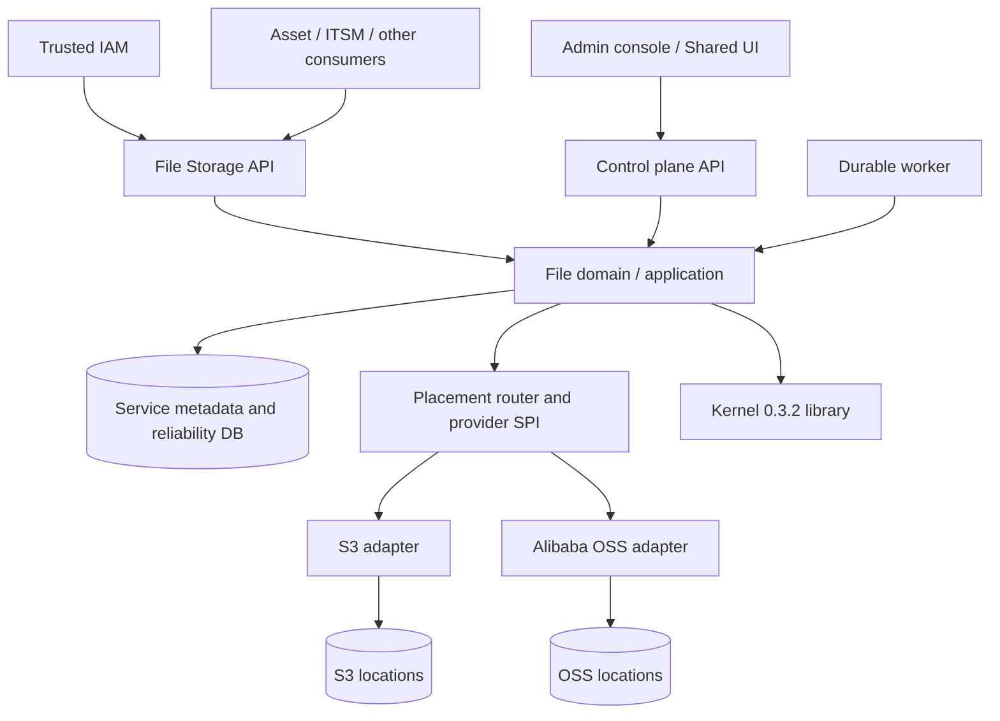

# Architecture and domain boundaries

Approved architecture direction; FS-110A/B verifier merged; FS-120A merged; FS-120B1 transactional initiation authorized. Start with a modular monolith; separate worker execution if scale or reliability requires. Java 21 / Maven / Spring Boot / PostgreSQL / Flyway approved; exact framework/database versions selected in relevant later increments.

## Boundaries
API authenticates and establishes context; domain enforces access and lifecycle; control plane governs backends/policies; persistence owns transactional metadata; provider adapters own SDKs and signing; worker reconciles asynchronous side effects. Kernel is a library, not a remote storage service. Consumer SDK speaks File Storage API; no direct bucket/database access.

## Conceptual model
- File: stable opaque ID, authoritative tenant, owner/application, logical name, state, current version.
- FileVersion: immutable content identity, verified size/digest/MIME, timestamps.
- StoredObject: version ID, location ID, physical key, provider version/generation if applicable, verification state. Multiple copies possible later.
- StorageBackend: adapter kind, connection parameters, credential reference, revisions/status.
- StorageLocation: stable backend + bucket/container/namespace; physical identity immutable once referenced.
- StoragePolicy: tenant/app/purpose rules and revision; select authorized location deterministically, fail closed if no match.
- UploadSession: actor/tenant, reserved quota, file/version, pinned location and policy/config revision, expiration and status.
- Operation/job and audit/event intents: durable recovery and accountability.

Logical file ID never changes on migration. Old location remains readable until verified cutover. Credential rotation may change connection revision without changing physical identity. Never silently repoint a referenced location to a different bucket. No automatic cross-tenant deduplication.

## Lifecycle and consistency
Initiate -> uploading -> verifying/scanning -> available or quarantined/failed. Expired/cancelled sessions release reservations and clean staged objects. Available -> soft deleted -> restored or purge pending -> purged only after retention/hold checks and verified deletion. Use optimistic concurrency or locked transitions, durable job leases/fencing, unique object keys and idempotent commands. Object store and DB do not share a transaction: stage, verify, commit metadata + required intents, reconcile uncertain effects. Never advertise availability before required verification.

## Deployment
One independent API/service release, console build, optional worker deployment. Service-owned metadata database, backend connections and secrets. No live credentials or deployment targets yet. Configuration control plane must converge revisions across instances and preserve existing reads during drain. Health distinguishes process liveness, readiness and per-backend degradation.
